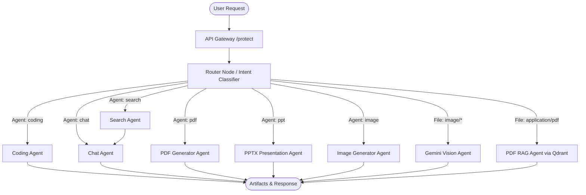

# 🧠 Cortex AI — Intelligent Multi-Agent Monorepo

<p align="center">
  
</p>

<p align="center">
  <strong>Next-Generation Autonomous Multi-Agent Workspace & Microservices Platform</strong>
</p>

<p align="center">
  
  
  
  
  
  
  
  
</p>

---

## 📖 Overview

**Cortex AI** is an enterprise-ready, multi-agent AI workspace architected as a microservices monorepo. It orchestrates specialized autonomous agents through **LangGraph** to deliver multimodal reasoning, full-stack code synthesis with live browser sandboxing, presentation design, automated document publishing, vision inspection, live web search, and contextual document retrieval (RAG).

The platform features built-in authentication, Redis-backed session authorization, a reverse-proxy API Gateway, usage-based credit consumption, Razorpay payment processing, and granular agent rate limiting.

---

## ✨ Key Capabilities & Agents

| Agent | Model / Engine | Description | Credits | Rate Limit |
|---|---|---|---|---|
| **🤖 Router Agent** | Llama 3.3 70B (Groq) | Analyzes user prompts or attached MIME types to dynamically route requests to the best agent. | Free | — |
| **💬 Chat Agent** | Llama 3.3 70B (Groq) | Long-context conversational assistant with sliding-window Redis conversation memory. | 1 Credit | 20 req/min |
| **💻 Coding Agent** | DeepSeek (OpenRouter) | Generates full-stack software artifacts (HTML/CSS/JS) rendered live in an integrated Monaco Editor & preview iframe. | 10 Credits | 5 req/min |
| **🌐 Search Agent** | Tavily Search + Llama 3.3 | Real-time internet lookups with citations, live sources, and inline imagery. | 5 Credits | 5 req/min |
| **📄 PDF Agent** | PDFKit + AWS S3 | Converts topics and research into structured, branded PDF publications delivered via presigned S3 URLs. | 10 Credits | 5 req/min |
| **📊 PPT Agent** | PptxGenJS + AWS S3 | Automatically builds 8-slide PowerPoint presentations with modern styling, stats cards, and key takeaways. | 10 Credits | 5 req/min |
| **🎨 Image Agent** | Pollinations AI + AWS S3 | Converts concise ideas into photorealistic prompts, generates high-res imagery, and stores them in AWS S3. | 10 Credits | 3 req/min |
| **👁️ Vision Agent** | Gemini 2.5 Flash | Multimodal image understanding, chart interpretation, text extraction, and scene analysis. | 10 Credits | — |
| **📚 PDF RAG Agent** | Qdrant Vector Store + Gemini Embeddings | Context-aware Q&A on user-uploaded PDF documents with semantic chunking and vector similarity search. | — | — |

---

## 🏗️ System Architecture

```
                                  ┌───────────────────────────┐
                                  │      Client Browser       │
                                  │   React 19 + Vite (5173)  │
                                  └─────────────┬─────────────┘
                                                │
                                                ▼  Cookie Auth (session)
                                  ┌───────────────────────────┐
                                  │    API Gateway (8000)     │
                                  │   (Reverse Proxy, Helmet) │
                                  └──────┬──────┬──────┬──────┘
                                         │      │      │      │
           ┌─────────────────────────────┘      │      │      └────────────────────────────┐
           ▼                                    ▼      ▼                                   ▼
┌──────────────────────┐   ┌──────────────────────┐  ┌──────────────────────┐   ┌──────────────────────┐
│  Auth Service (8001) │   │  Chat Service (8002) │  │  Agent Service (8003)│   │Billing Service (8004)│
│  - Firebase Auth     │   │  - Conversations     │  │  - LangGraph Graph   │   │  - Razorpay Orders   │
│  - Session Management│   │  - Messages          │  │  - Specialized Agents│   │  - Webhook / Verify  │
│  - User Credits      │   │  - Artifacts Data    │  │  - S3 / Qdrant / LLMs│   │  - Plan Upgrades     │
└──────────┬───────────┘   └──────────┬───────────┘  └──────────┬───────────┘   └──────────┬───────────┘
           │                          │                         │                          │
           └──────────────────────────┴────────────┬────────────┴──────────────────────────┘
                                                   │
                                      ┌────────────┴────────────┐
                                      │  Shared Infrastructure  │
                                      │  - MongoDB (Database)   │
                                      │  - Redis (Sessions/TTL) │
                                      │  - AWS S3 (Bucket)      │
                                      │  - Qdrant (Vector DB)   │
                                      └─────────────────────────┘
```

### LangGraph Supervisor Workflow



---

## 📁 Monorepo Layout

```
cortex-ai/
├── backend/
│   ├── docker-compose.yml             # Redis service orchestration
│   ├── package.json                   # Backend root metadata and dependencies
│   ├── shared/
│   │   └── redis/redis.js             # Shared Redis client connection
│   ├── gateway/                       # Port 8000: API Gateway & Auth Proxy
│   │   ├── index.js                   # Gateway routing and static proxying
│   │   ├── middlewares/auth.middleware.js # Session verification via Redis
│   │   ├── controllers/user.controller.js # /api/me handler
│   │   ├── utils/proxyWithHeaders.js  # Injects user headers (x-user-id, email)
│   │   └── Dockerfile
│   └── services/
│       ├── auth/                      # Port 8001: Authentication & User Accounts
│       │   ├── index.js
│       │   ├── controllers/auth.controllers.js # Google/Firebase token verification
│       │   ├── routes/auth.routes.js  # /login, /logout, credit endpoints
│       │   └── models/user.model.js   # User schema, credit balance, plan tier
│       ├── chat/                      # Port 8002: Conversation & Message Storage
│       │   ├── index.js
│       │   ├── controllers/chat.controller.js # Conversation CRUD and message sync
│       │   ├── routes/chat.routes.js  # Chat history endpoints
│       │   └── models/                # Conversation & Message schemas (with artifacts)
│       ├── agent/                     # Port 8003: LangGraph Multi-Agent Engine
│       │   ├── index.js
│       │   ├── graph/                 # StateGraph, AgentState, Router Node
│       │   ├── agents/                # Chat, Coding, PDF, PPT, Image, Vision, RAG
│       │   ├── config/                # Multer upload limits, agentRateLimit
│       │   └── utils/                 # S3 helpers, VectorStore, Tavily, Redis Memory
│       └── billing/                   # Port 8004: Subscriptions & Payment Processing
│           ├── index.js
│           ├── config/plans.js        # Free, Starter, Pro pricing tiers
│           ├── controllers/billing.controller.js # Razorpay order creation & HMAC verification
│           ├── routes/billing.routes.js # /create-order, /verify-payment
│           └── models/payment.model.js# Payment transaction history
└── frontend/                          # Port 5173: Modern React 19 Client
    ├── index.html
    ├── vite.config.js
    ├── firebase.js                    # Firebase Client Auth (Google Popup)
    └── src/
        ├── App.jsx                    # Root view and user initialization
        ├── pages/Home.jsx             # Main dashboard layout
        ├── components/
        │   ├── ArtifactPanel.jsx      # Monaco Editor + Live Sandboxed HTML Preview
        │   ├── ChatArea.jsx           # Main chat timeline & composer
        │   ├── ChatInput.jsx          # Speech-to-text, agent switcher, attachments
        │   ├── Sidebar.jsx            # Conversation list, credits bar, user drawer
        │   ├── BillingDrawer.jsx      # Razorpay payment checkout drawer
        │   ├── MessageBubble.jsx      # GFM Markdown, syntax highlighting, image previews
        │   └── AiBanner.jsx           # Rate limit & credit warning banners
        ├── features/                  # API abstraction (agent, chat, billing, auth)
        └── redux/                     # Redux Toolkit store (user, conversation, message)
```

---

## 💳 Pricing & Credit System

Cortex AI implements a token/credit-based economy to govern AI computational costs:

| Plan | Price (INR) | Monthly Credits | Validity |
|---|---|---|---|
| **Free** | ₹0 | 100 Credits | 30 Days |
| **Starter** | ₹199 | 500 Credits | 30 Days |
| **Pro** | ₹499 | 1,000 Credits | 30 Days |

### Credit Cost Breakdown
- **General Chat**: `1 Credit`
- **Web Search**: `5 Credits`
- **Code Synthesis**: `10 Credits`
- **PDF Generation**: `10 Credits`
- **Presentation Creation**: `10 Credits`
- **Image Generation**: `10 Credits`
- **Vision Analysis**: `10 Credits`

---

## 💻 Tech Stack

### Frontend
- **Framework**: [React 19](https://react.dev/) + [Vite 8](https://vitejs.dev/)
- **Styling**: [Tailwind CSS v4](https://tailwindcss.com/)
- **Code Editor**: [@monaco-editor/react](https://github.com/suren-atoyan/monaco-react)
- **State Management**: [Redux Toolkit](https://redux-toolkit.js.org/) + React-Redux
- **Animations & Icons**: [Framer Motion](https://www.framer.com/motion/), [Lucide React](https://lucide.dev/), [React Icons](https://react-icons.github.io/react-icons/)
- **Markdown & Code Display**: `react-markdown`, `remark-gfm`, `react-syntax-highlighter`
- **Speech Recognition**: Web Speech API (`webkitSpeechRecognition`)

### Backend & AI
- **Runtime**: [Node.js](https://nodejs.org/) (ES Modules) + Express 5
- **Agent Framework**: [LangChain](https://js.langchain.com/) & [LangGraph](https://langchain-ai.github.io/langgraphjs/)
- **LLM Providers**:
  - Groq (`llama-3.3-70b-versatile`)
  - OpenRouter (`deepseek/deepseek-chat`)
  - Google Gemini (`gemini-2.5-flash`, `gemini-embedding-001`)
- **Vector Database**: [Qdrant](https://qdrant.tech/)
- **Search Tool**: [Tavily AI Search](https://tavily.com/)
- **Storage**: [AWS S3](https://aws.amazon.com/s3/) (`@aws-sdk/client-s3`, `@aws-sdk/s3-request-presigner`)
- **Document Engines**: [PDFKit](https://pdfkit.org/), [PptxGenJS](https://gitbrent.github.io/PptxGenJS/), [pdf-parse](https://www.npmjs.com/package/pdf-parse)
- **Database & Cache**: [MongoDB](https://www.mongodb.com/) via Mongoose, [Redis](https://redis.io/) via `ioredis`
- **Payments & Auth**: [Razorpay](https://razorpay.com/), [Firebase Admin SDK](https://firebase.google.com/)

---

## ⚙️ Environment Variables

Create `.env` files in each respective directory based on the following configurations:

### 1. Gateway (`backend/gateway/.env`)
```env
PORT=8000
REDIS_URL="redis://localhost:6379"
AUTH_SERVICE="http://localhost:8001"
CHAT_SERVICE="http://localhost:8002"
AGENT_SERVICE="http://localhost:8003"
BILLING_SERVICE="http://localhost:8004"
```

### 2. Auth Service (`backend/services/auth/.env`)
```env
PORT=8001
MONGODB_URL="mongodb://localhost:27017/cortex_auth"
FRONTEND_URL="http://localhost:5173"
```
*(Also supply `backend/services/auth/serviceAccount.json` for Firebase Admin)*

### 3. Chat Service (`backend/services/chat/.env`)
```env
PORT=8002
MONGODB_URL="mongodb://localhost:27017/cortex_chat"
```

### 4. Billing Service (`backend/services/billing/.env`)
```env
PORT=8004
MONGODB_URL="mongodb://localhost:27017/cortex_billing"
AUTH_SERVICE="http://localhost:8001"
RAZORPAY_KEY_ID="rzp_test_..."
RAZORPAY_KEY_SECRET="..."
```

### 5. Agent Service (`backend/services/agent/.env`)
```env
PORT=8003
MONGODB_URL="mongodb://localhost:27017/cortex_agent"
GOOGLE_API_KEY="AIzaSy..."
GROQ_API_KEY="gsk_..."
OPENROUTER_API_KEY="sk-or-..."
TAVILY_API_KEY="tvly-..."
GATEWAY_URL="http://localhost:8000"
CHAT_SERVICE="http://localhost:8002"
AUTH_SERVICE="http://localhost:8001"
AWS_ACCESS_KEY_ID="AKIA..."
AWS_SECRET_ACCESS_KEY="..."
AWS_REGION="ap-south-1"
AWS_BUCKET_NAME="cortex-ai-assets"
QDRANT_URL="https://your-qdrant-cluster.qdrant.tech"
QDRANT_API_KEY="..."
```

### 6. Frontend (`frontend/.env`)
```env
VITE_SERVER_URL="http://localhost:8000"
VITE_FIREBASE_API_KEY="..."
VITE_RAZORPAY_KEY="rzp_test_..."
```

---

## 🚀 Quickstart & Installation

### Prerequisites
- **Node.js** >= 18.0.0
- **Docker** & **Docker Compose** (for Redis)
- **MongoDB** instance (local or Atlas)
- **API Keys**: Google Gemini, Groq, OpenRouter, Tavily, AWS S3, Razorpay, Firebase

### 1. Clone the Repository
```bash
git clone https://github.com/your-username/cortex-ai.git
cd cortex-ai
```

### 2. Start Redis
```bash
cd backend
docker-compose up -d
cd ..
```

### 3. Install Dependencies

You can install dependencies for each service individually:

```bash
# Backend root
cd backend && npm install

# Gateway
cd gateway && npm install

# Microservices
cd ../services/auth && npm install
cd ../chat && npm install
cd ../agent && npm install
cd ../billing && npm install

# Frontend
cd ../../../frontend && npm install
```

### 4. Run the Platform

Open separate terminal windows or use your preferred process manager (e.g., `concurrently` or `pm2`):

```bash
# Terminal 1: Auth Service (Port 8001)
cd backend/services/auth && npm run dev

# Terminal 2: Chat Service (Port 8002)
cd backend/services/chat && npm run dev

# Terminal 3: Agent Service (Port 8003)
cd backend/services/agent && npm run dev

# Terminal 4: Billing Service (Port 8004)
cd backend/services/billing && npm run dev

# Terminal 5: API Gateway (Port 8000)
cd backend/gateway && npm run dev

# Terminal 6: Frontend Client (Port 5173)
cd frontend && npm run dev
```

Visit **`http://localhost:5173`** in your browser.

---

## 🔌 API Endpoints Summary

All external client requests flow through the API Gateway at `http://localhost:8000`:

| Route | Target Microservice | Description | Protected |
|---|---|---|:---:|
| `POST /api/auth/login` | Auth (8001) | Authenticates Firebase ID token & sets session cookie | ❌ |
| `GET /api/auth/logout` | Auth (8001) | Invalidates session and clears cookie | ❌ |
| `GET /api/me` | Gateway / Auth | Returns the active user's profile, credits, and tier | ✅ |
| `POST /api/agent/chat` | Agent (8003) | Dispatches prompt + file to the LangGraph supervisor | ✅ |
| `POST /api/chat/create-conversation` | Chat (8002) | Creates a new conversation thread | ✅ |
| `GET /api/chat/get-conversations` | Chat (8002) | Fetches user's conversation history | ✅ |
| `GET /api/chat/get-messages/:id` | Chat (8002) | Retrieves all messages & artifacts for a thread | ✅ |
| `POST /api/chat/update-conversation` | Chat (8002) | Renames conversation title | ✅ |
| `POST /api/billing/create-order` | Billing (8004) | Initiates a Razorpay order for plan upgrade | ✅ |
| `POST /api/billing/verify-payment` | Billing (8004) | Verifies payment signature & grants credits | ✅ |

---

## 🔒 Security & Data Flow

- **Session Security**: Session tokens are cryptographically generated UUIDs stored in Redis with 7-day TTL and transmitted via `httpOnly`, `sameSite: lax` cookies.
- **Identity Propagation**: The Gateway decrypts the session from Redis and forwards verified user metadata to internal microservices using custom HTTP headers (`x-user-id`, `x-user-email`, `x-user-avatar`).
- **Resource Protection**: Internal mutation routes (such as `/internal/update-plan` and `/internal/deduct-credits`) are isolated and accessible only within the internal service network.
- **Rate-Limiting**: Granular rate limiting on high-compute agents (e.g., Coding, Images, PPT) prevents API quota exhaustion and abuse.

---

## 🤝 Contributing

Contributions are welcome! Follow these steps:
1. Fork this repository.
2. Create your feature branch (`git checkout -b feature/amazing-feature`).
3. Commit your changes (`git commit -m 'Add amazing agent feature'`).
4. Push to your branch (`git push origin feature/amazing-feature`).
5. Open a Pull Request.

---

## 📄 License

This project is licensed under the **ISC License**.
